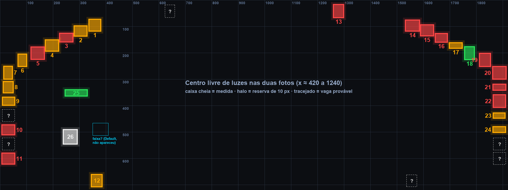
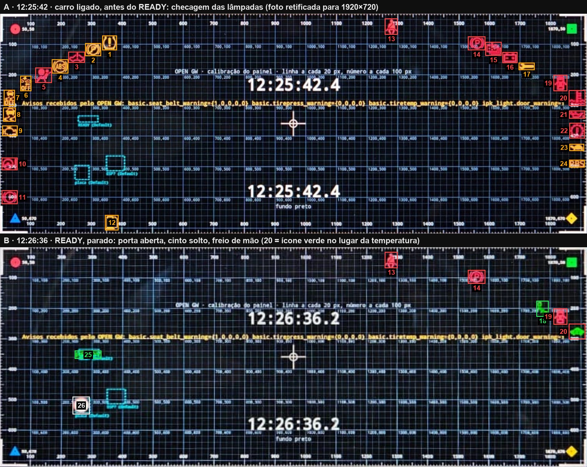
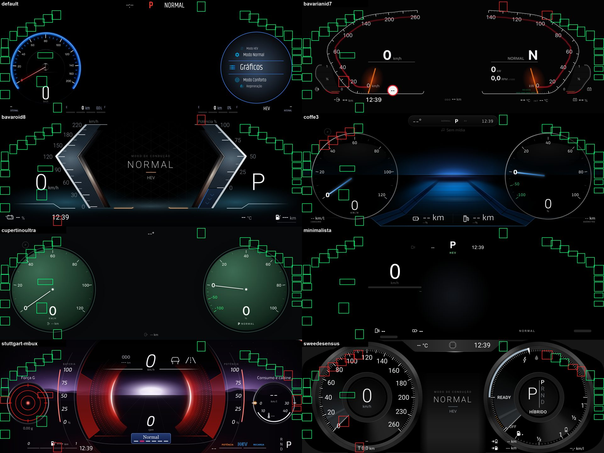

# Mapa das luzes e avisos do painel (1920×720)

Atualizado em 29/09/2026 (Alpha 9.3): SENSUS com o mostrador esquerdo no lugar do de fábrica. Na 9.2, luzes 27 e 28 e os temas do APK reencaixados. Primeira medição
no carro em 27/09/2026, com a Calibração do painel da Alpha 8.8.

- **Fonte:** 2 fotos do usuário:
  - **A** às 12:25:42: carro ligado antes do READY, na checagem das lâmpadas;
  - **B** às 12:26:36: READY, parado, porta aberta, cinto solto e freio de mão puxado.
- **Ainda não usado:** o pacote `.zip` da sessão continua na central, em `/sdcard/OpenGW/calibracao/`. Veja "O que falta".
- **Dados para ferramentas:** [`mapa-de-luzes/mapa-luzes-1920x720.json`](mapa-de-luzes/mapa-luzes-1920x720.json).
- **Medição de fotos novas:** [`tools/calibracao-painel/medir_foto.py`](../../tools/calibracao-painel/medir_foto.py).

## Resumo

1. **As luzes do carro ficam por cima do tema.** Nas duas fotos, as luzes aparecem sobre a grade com fundo preto opaco, que é o tema no Display 3. Um tema não consegue cobrir nem mover essas luzes; só pode deixar o lugar livre.
2. **As posições são fixas.** Cinto (13), freio de mão (14) e porta (19) caem no mesmo pixel nas duas fotos, com diferença de até 3 px.
3. **O desenho é espelhado em x = 960.** Cada lado tem:
   - uma diagonal de 6 luzes descendo para a borda: esquerda de (358,95) a (84,228), direita de (1558,96) a (1832,226);
   - uma coluna colada na borda, com vagas a cada ~54 px em y ≈ 275, 330, 383, 437, 491, 545 e 600. A coluna esquerda fica em x ≈ 8–55 e a direita em x ≈ 1863–1911.

   O espelho bate com 3–4 px de diferença em todos os pares, o que confirma a medição.
4. **Luzes isoladas:**
   - cinto no topo, em x ≈ 1261–1297;
   - combustível na base esquerda, em x ≈ 346–384;
   - READY e a placa dentro do mostrador esquerdo.
5. **Faixa central livre:** x ≈ 420 a 1240 não tem nenhuma luz nas duas fotos.
6. **READY e placa confirmados.** As coordenadas antigas, tiradas do mock do Default, estavam certas com diferença de até ~11 px. As zonas de segurança atuais cobrem o que foi medido.
7. **A zona "ESP" do contrato não acendeu em nenhuma das fotos.** O ESP de verdade está na coluna esquerda (7 e 8). Aquela zona em 350,466 desenha, no mock do Default, um carro entre faixas, provavelmente o assistente de faixa. **A confirmar**: ela só deve aparecer com o ADAS ativo, andando.
8. **A tela inteira aparece.** As quatro bordas da grade estão visíveis, então a moldura do painel não corta nada dos 1920×720.

## Como foi medido

- **Correção da foto:** homografia pelas 4 marcas coloridas dos cantos, refinada com os cruzamentos da grade de 100 px e uma correção cúbica da lente:
  - foto A: 357 pontos, erro rms de 1,1 px do painel (máximo 2,5);
  - foto B: 387 pontos, erro rms de 1,5 px (máximo 3,8).
- **Caixas:** detectadas pela cor (vermelho, âmbar, verde e branco) na foto corrigida. Elas incluem o brilho da câmera, por isso a luz real é 2 a 4 px menor de cada lado.
- **Resolução da foto:** 1280×720 comprimida. Na foto A, 1 px da foto vale ~1,7 px do painel; na B, ~2,5 px.

## As luzes

Formato das coordenadas: `x, y, w, h` em px do painel. A coluna "Quando" separa:

- **uso:** acende no dia a dia;
- **partida:** só na checagem das lâmpadas (~3 s) ou numa falha real;
- **motorista:** acende quando o motorista desliga a função.

A confiança vale para a identificação do ícone. A posição é medida e vale para todos.

| # | Luz | Cor | x, y, w, h | Quando | Confiança |
|---:|---|---|---|---|---|
| 1 | Pressão dos pneus (TPMS) | âmbar | 337, 74, 43, 43 | partida | alta |
| 2 | Freio de estacionamento, falha (P âmbar) | âmbar | 281, 99, 47, 37 | partida | alta no ícone; média no significado |
| 3 | Carro com "!" (falha do sistema?) | vermelho | 226, 127, 49, 31 | partida | baixa |
| 4 | ABS | âmbar | 172, 152, 49, 41 | partida | alta |
| 5 | Airbag | vermelho | 118, 179, 49, 45 | partida | alta |
| 6 | Colisão "OFF" (frenagem automática desligada?) | âmbar | 69, 206, 31, 45 | partida / motorista | média |
| 7 | ESP OFF | âmbar | 15, 252, 31, 47 | partida / motorista | alta |
| 8 | ESP / controle de tração | âmbar | 13, 310, 36, 41 | partida | alta |
| 9 | Injeção (check engine) | âmbar | 10, 369, 45, 29 | partida | alta |
| 10 | Direção elétrica (volante com "!") | vermelho | 8, 474, 47, 36 | partida | média |
| 11 | Sistema de freio | vermelho | 8, 581, 47, 40 | partida | média |
| 12 | Combustível baixo | âmbar | 346, 662, 39, 45 | partida / **uso** | alta |
| 13 | Cinto de segurança | vermelho | 1261, 18, 37, 48 | **uso** | alta |
| 14 | Freio de estacionamento acionado (P) | vermelho | 1533, 77, 52, 40 | **uso** (toda parada) | alta |
| 15 | Bateria de alta tensão | vermelho | 1590, 95, 48, 40 | partida | média |
| 16 | Bateria 12 V / carga | vermelho | 1646, 128, 44, 31 | partida | alta |
| 17 | Chave inglesa (manutenção) | âmbar | 1699, 163, 47, 19 | partida | média |
| 18 | Ícone verde (cabo de recarga?) | verde | 1757, 178, 35, 47 | **uso** (foto B) | baixa |
| 19 | Porta aberta (carro visto de cima) | vermelho | 1813, 203, 40, 48 | **uso** | média |
| 20 | Temperatura do motor. Na foto B, um ícone **verde** em forma de carro ocupa a mesma vaga | vermelho / verde | 1863, 253, 49, 46 | partida / **uso** | alta (vermelho); baixa (verde) |
| 21 | Pressão do óleo | vermelho | 1864, 320, 47, 21 | partida | alta |
| 22 | Engrenagem com termômetro (transmissão ou motor elétrico?) | vermelho | 1865, 360, 45, 46 | partida | baixa |
| 23 | Potência limitada (tartaruga) | âmbar | 1865, 429, 43, 18 | partida | alta |
| 24 | "RBS" (frenagem regenerativa?) | âmbar | 1864, 481, 46, 20 | partida | baixa |
| 25 | READY | verde | 247, 341, 82, 22 | **uso** | alta |
| 26 | Placa de velocidade (leitor de placas; mostra "---" sem placa) | branco / vermelho | 240, 492, 51, 53 | **uso** | alta |
| 27 | Sol verde (luz diurna ou farol automático) | verde | 394, 59, 44, 39 | **uso** (farol aceso) | média |
| 28 | Lanterna (luz de posição) | verde | 444, 53, 49, 27 | **uso** (farol aceso) | média |

**Luzes 27 e 28 (28/09/2026, 21:18-21:19).** Duas fotos do usuário com o carro em P e o farol aceso,
uma com o Sweede SENSUS e outra com o Bávaro ID8. Sem a grade de calibração: a foto foi corrigida
pela homografia dos quatro cantos da tela mais as luzes 13, 14 e 18, que já estavam medidas (erro de
4 a 6 px nas três). As duas luzes continuam o arco da diagonal esquerda para cima, depois da 1. O farol
verde que aparece no canto de cima à esquerda nas mesmas fotos **não é do carro**: era o ícone do
próprio tema (`#farol` do SENSUS e do ID8, x 36-90 e 56-112), que saiu na 9.2.

**Vagas prováveis.** Estes lugares não acenderam em nenhuma das duas fotos, mas a simetria e o passo das colunas indicam que existe luz neles. Todos estão **A confirmar**:

| Vaga | x, y, w, h | Por quê |
|---|---|---|
| Coluna esquerda, y ≈ 437 | 8, 414, 47, 46 | O passo da coluna pula essa posição |
| Coluna esquerda, y ≈ 545 | 8, 522, 47, 46 | Mesmo motivo |
| Coluna direita, y ≈ 545 | 1864, 522, 47, 46 | Espelho da direção (10) e passo da coluna |
| Coluna direita, y ≈ 600 | 1864, 577, 47, 46 | Espelho do freio (11) |
| Topo esquerdo | 623, 18, 37, 48 | Espelho do cinto (13) |
| Base direita | 1536, 662, 39, 45 | Espelho do combustível (12) |
| Espelho da luz diurna | 1482, 59, 44, 39 | Espelho da 27 |
| Espelho da lanterna | 1427, 53, 49, 27 | Espelho da 28 |

As outras luzes verdes e azuis (farol alto, neblina, setas, auto hold, piloto automático) não apareceram em nenhuma foto. É provável que ocupem essas vagas ou fiquem no topo; nada disso foi medido.

## Regras para quem desenha tema

- **Luz e aviso são só os do carro (decisão do dono, 28/09/2026).** O tema não desenha cinto, porta,
  temperatura, óleo, pneus, combustível baixo, farol, ESP, ponto cego, READY nem freio de mão. O carro
  já desenha os dele por cima; um do tema aparecia duplicado e em outro lugar. Desde a 9.2 o projetor
  nem entrega mais ao tema o aviso em si (`updateWarning`) e as setas de ponto cego
  (`bsdLeft`/`bsdRight`); só o `warningActive`, para ceder a tela ao pop-up do carro.
- **Nada do mostrador embaixo de luz (28/09/2026).** Aro, traço, número e rótulo ficam por fora de
  toda caixa + 10 px. A placa e o READY ficam dentro do mostrador da esquerda no painel de fábrica, e a
  diagonal fica por fora dele, a ~10 px: um mostrador de aro grosso não cabe entre os dois. Nesse caso
  ou o miolo do mostrador (sem número nem traço) fica embaixo deles, como no Cupertino e no coffe3, ou
  o mostrador inteiro vai para dentro, com as luzes todas por fora, como no SENSUS da 9.2 (ficou
  pequeno demais no carro), ou o mostrador fica **no lugar do de fábrica**, como no SENSUS da 9.3.
- **O mostrador de fábrica (medido na 9.3).** A diagonal da esquerda é um arco em volta de um ponto
  perto de (410, 450). Um mostrador redondo centrado ali cabe inteiro por dentro do arco até ~0,8 do
  SENSUS (raio 284), e o READY e a placa caem na face dele, entre o cubo e os traços. Para ficarem na
  face lisa, sem número embaixo, o SENSUS numera a cada 40 km/h (sete números, um a cada 45°) e o
  cubo encolhe 0,875; com número a cada 20 não sobra vão. O combustível (12) cai embaixo, no vão da
  escala, e ali o aro do SENSUS se apaga.

- **Onde não desenhar:** nenhum número, texto, ícone ou marcação da escala dentro de uma caixa da tabela mais 10 px de folga. É o halo do esquema.
- **O que pode passar por baixo:** um traço fino ou um ponteiro, como já diz a regra do READY em `THEME_GUIDE.md`. O miolo do mostrador pode ficar embaixo.
- **Faixas para lembrar:**
  - bordas esquerda e direita: x < 66 e x > 1852, de y 240 a 632;
  - diagonais: uma faixa de ~60 px ao longo de (84,228)→(358,95) e do espelho (1562,95)→(1836,228). É onde a escala de um velocímetro redondo grande costuma cair;
  - topo: cinto em x 1251–1307, y < 76, e a vaga espelhada em x 613–669;
  - base: combustível em x 336–394, y > 652, e a vaga espelhada em x 1526–1584.
- **Prioridade:** as luzes marcadas como **uso** aparecem sempre (READY, placa, freio de mão, cinto, porta, combustível baixo e os verdes). As de **partida** somem em ~3 s e, quando acendem de verdade, importam mais que o tema.
- **Como encaixar um tema (decisão do dono, 27/09/2026):** mude a composição inteira, nunca uma peça solta.
  - Um mostrador redondo encolhe **inteiro** (aro, traços, números, ponteiro, leitura central) em volta do próprio centro, e os dois centros continuam espelhados em x = 960. As luzes da diagonal ficam então por fora do aro, como num painel físico.
  - Uma leitura continua no eixo do mostrador dela. Um grupo (valor + unidade, barra + rótulos + relógio) anda junto.
  - Não vale puxar um número para dentro da borda, empurrar uma leitura para o lado ou mover só um rótulo. Fica desleixado mesmo sem conflito.

## Auditoria dos temas que vêm no APK

**Método:**
- Cada tema foi renderizado em 1920×720 num navegador sem interface, parado (0 km/h, P, sem dados), junto com a imagem de fundo quando o tema tem uma.
- Em cada caixa da tabela mais 8 px, contei os pixels com borda forte, ou seja, conteúdo legível e não um preenchimento liso.
- Resultado completo em [`mapa-de-luzes/auditoria-temas.json`](mapa-de-luzes/auditoria-temas.json).

| Tema | Conflitos | Gravidade |
|---|---|---|
| **Sweede SENSUS** | Números **100 e 120** da escala sob 1 e 2, **80** sob 4, traços sob 3, 5 e 14. **"T 0,0 km"** sob o combustível (12). Escala do mostrador direito sob 17 e 18. Traço/número sob a placa (26) | **grave**: a escala do velocímetro corre bem na diagonal das luzes |
| **Bávaro ID8** | **"Potência %"** sob o cinto (13); o **relógio** sob o combustível (12) | **grave** (texto) |
| **Stuttgart MBUX** | **"cabine"** (de "Consumo e cabine") sob a porta (19); **"--- km"** sob o combustível (12); arcos sob o READY, 9, 22 e 23 | grave (texto) + leve (arcos) |
| Bavarian ID7 | Traços da escala sob a placa (26), o cinto (13) e o freio de mão (14) | leve |
| NTG (coffe3) | Arco do velocímetro sob 2 a 5 | leve (só traço) |
| Default, Cupertino Ultra, Minimalista | nenhum | — |

Recortes de cada conflito: [`mapa-de-luzes/conflitos.jpg`](mapa-de-luzes/conflitos.jpg).

Limites desta auditoria:
- ela vê só o estado parado: ponteiros e valores mudam andando;
- temas baixados que não vêm no APK não entraram.

## Temas do APK encaixados (Alpha 8.9)

Na primeira tentativa os temas foram só "desviados": números puxados para dentro da borda no SENSUS, a velocidade do Cupertino empurrada para o lado, um rótulo solto no MBUX. Tudo foi refeito pela regra de composição acima.

Método:
- Renderizados a 188 km/h, com 1050 km e 100 % (o pior caso de largura).
- Checagem da tinta de cada texto contra as caixas + 10 px.
- Folha de antes e depois: [`mapa-de-luzes/temas-apk-antes-depois.jpg`](mapa-de-luzes/temas-apk-antes-depois.jpg).

| Tema | O que mudou | Resultado |
|---|---|---|
| **Sweede SENSUS** 1.1.0 | Os dois mostradores inteiros encolhem 0,8 em volta de (417, 375) e (1503, 375), pelo gerador (`ESCALA`, grupos com `matrix`; os textos em HTML saem do bloco `GERADO:css`). O "0" da escala fica só com o traço, porque a placa cai em cima dele. | Luzes 1–5 e 14–17 assentam no aro, e os traços ficam a 10 px delas. READY no 9 horas, entre o "40" e a velocidade. |
| **Cupertino Ultra** 1.8.0 | `--mostrador: 0.93` escala face, SVG (pela `viewBox`) e leitura. Centros em 380 e 1540. O "P" do freio de mão vai para o canto espelhado. | Luzes por fora do anel, a 6–8 px. Placa entre o "0" e a velocidade, que voltou para o eixo. |
| **NTG 5.5 clássico (coffe3)** 0.15.0 | Mesmo esquema, com `--mostrador: 0.9`, centros em 374 e 1546 e a face fumê da projeção junto. | Luzes por fora do aro, a 9–12 px. Placa entre o "0" e a velocidade. |
| **Stuttgart MBUX** 1.0.2 | Os círculos laterais continuam inteiros menores (raio 80). A barra de combustível inteira ficou mais curta (4 × 58 px) e acaba antes da luz 12, com a autonomia de volta no centro dela. O relógio vem depois da luz. | Nenhum texto sob luz. A luz de combustível fica no vão entre a barra e o relógio. |
| **Bávaro ID8** 1.0.1 | Velocidade e km/h sobem juntos, 10 px, entre o READY e a placa. Os títulos das escalas mostram só a unidade, espelhados (580 / 1340). Relógio e temperatura estão espelhados. | Nenhum texto sob luz. |
| Bavarian ID7 | Sem mudança: o contorno do mostrador já passa por dentro da diagonal. | O READY fica a 7 px do "60", na diagonal, o mesmo caso do SENSUS com o "40". Aceito: nenhum encaixe proporcional abre mais espaço ali. |
| Minimalista | Sem mudança. | Limpo. |
| Default | Não mexido: é gerado pelo Parcel (`cluster-widgets/source/v1.0/default`) e o `node_modules` não está instalado. | A velocidade "201" fica a 3 px da placa. Pendente. |

### Alpha 9.2 (28/09/2026, fotos do SENSUS e do ID8 no carro)

O dono pediu: nenhuma luz do carro em cima de parte nenhuma do mostrador, e nenhum ícone de aviso
desenhado pelo tema. Folha de antes e depois: [`mapa-de-luzes/temas-apk-9.2-antes-depois.jpg`](mapa-de-luzes/temas-apk-9.2-antes-depois.jpg).

| Tema | O que mudou | Resultado (render parado e a 188 km/h, caixas + 8 px) |
|---|---|---|
| **Sweede SENSUS** 1.2.0 | Os dois mostradores inteiros encolhem para 0,58 (antes 0,8) com centros em (544, 375) e (1376, 375): o aro passa a 8 px do READY e encosta no painel do centro. Nenhuma luz fica dentro do mostrador, então o "0" da escala voltou. A aba de cima (temperatura, ícone, hora) encolhe 0,87 em volta do meio, para o canto dela sair de baixo do cinto. Fundo de um tom só (sem a moldura #161616, sem os círculos da "tela preta" e sem o degradê do centro). Sem aviso, farol, ESP e ponto cego próprios. | Nenhum pixel do tema sob as 28 luzes nem sob as vagas prováveis. |
| **Bávaro ID8** 1.1.0 | Os dois chevrons inteiros (aro, face, traços, rótulos, títulos, enchimento, zona de recarga) encolhem 0,936 em volta do meio da própria base (610, 604) e o espelho: a base fica no horizonte e o topo desce de 72 para 106. O clarão e a marca do limite (HTML) passam pela mesma conta (`naTela`). Sem aviso, farol, ESP, ponto cego e READY próprios; o "EV" continua. | O "220" saiu de baixo da lanterna (28) e a linha do topo direito, de baixo do cinto (13). |
| **Stuttgart MBUX** 1.1.0 | Sem aviso, farol, ESP, faixas (com o ponto cego), lâmpada vermelha e READY próprios. Geometria igual. | Só a vaga provável da base direita (1536, 662) fica sobre a barra "Potência/HEV/Recarga" (A confirmar se há luz ali). |
| **NTG 5.5 clássico (coffe3)** 0.16.0 e **Cupertino Ultra** 1.9.0 | Sem o "P" do freio de mão. Geometria igual à da 8.9. | Diagonal por fora do anel; READY e placa no miolo, sem número nem traço embaixo. No coffe3, a linha fina do chão (no `car-bg.jpg`) passa na borda de cima da caixa do combustível (12). |
| **Minimalista** | Sem o ícone do farol (gerado de novo pelo `gerar-tema-preinstalado.mjs`; saiu também da predefinição do editor). | Limpo. |
| Bavarian ID7 | **Sem mudança: pendente, precisa de decisão.** O aro dele contorna o canto esquerdo exatamente por onde passam a diagonal, o READY e a placa. Testada a escala inteira do painel (a do `#app`, 0,84 a 0,93, com o centro da escala em y 0 a 720): quando a diagonal sai de cima do aro, o "60" e a faixa caem sob o READY e o "20" e os traços, sob a placa. Só sai limpo com os mostradores bem menores e para dentro (como o SENSUS, ~0,63), o que muda a cara do tema. | Hoje: escala e aro sob 1, 2, 13-15, 26, 27 e 28. |

### Alpha 9.3 (29/09/2026): SENSUS grande de novo

O dono achou os mostradores da 9.2 pequenos demais e pediu para aumentá-los com o READY e a placa em
harmonia com o tema. Folha de antes e depois (READY, placa e sol simulados sobre o render):
[`mapa-de-luzes/sensus-9.3-antes-depois.jpg`](mapa-de-luzes/sensus-9.3-antes-depois.jpg).

| Tema | O que mudou | Resultado |
|---|---|---|
| **Sweede SENSUS** 1.3.0 | Mostradores inteiros a 0,8 (os da 9.2 eram 0,58), o esquerdo em (426, 434) e o direito no espelho (1494, 434): o do meio de fábrica. Cubo 0,875 (anel, velocidade, câmbio e PRND juntos). Número a cada 40 km/h (0, 40, ..., 200, 260) e traço maior a cada 20. O aro escurece a partir dos traços do 0 e do 260 e some embaixo (247° a 293°). Hodômetro e trecho sobem para o vão de baixo da escala (saíram de cima do aro). A placa própria do tema saiu: a do carro fica dentro do mostrador (a marca vermelha na escala e a velocidade âmbar acima do limite continuam). | Diagonal, farol, lanterna, cinto e freio de mão a ~30 px ou mais do aro (o combustível fica no trecho em que o aro some). READY a 8 px do cubo e 36 px do "80"; placa a 8 px dos traços e 21 px do "0" (conferido também no `test-painel-original.mjs`). A 188 km/h, nenhum pixel do tema nas caixas do READY e da placa; parado, só o degradê da face (a luz do ponteiro passa por baixo deles, como pelo READY do próprio tema no mostrador direito). A vaga provável da base direita (1536, 662) encosta no arco do combustível do mostrador direito (A confirmar se há luz ali). |

Temas XTRA (catálogo do instalador): o projetor não entrega mais o aviso nem o ponto cego, então a
pílula de aviso e as setas deles não acendem mais. Uns 25 XTRA ainda têm ícone próprio de ESP e uns 17
leem o farol (alguns só para o modo noturno): o passe XTRA continua pausado (decisão do dono).

A caixa da projeção (`setProjectionBox`) do Cupertino e do coffe3 não mudou. As bordas continuam embaixo das faces, e a geometria do vídeo fica igual.

## O que falta (A confirmar)

1. **Pacote `.zip` da sessão.** Está no carro em `/sdcard/OpenGW/calibracao/calibracao-<data>.zip`; baixe pelo instalador em Arquivos. Com ele dá para responder:
   - qual chave do carro acende junto com cada luz (`linha-do-tempo.tsv`, `mudancas.tsv`, `vhal.tsv`);
   - se as luzes são desenhadas pelo Android ou fora dele, pelo QNX. Se aparecerem nas `tela-N.png` da captura, são Android; se não, são QNX.
   - **Leitura parcial (30/09, Alpha 9.3, pelo GwLink):** com `car.ipk_light.seat_belt_warning_indicator = 1` e `car.basic.seat_belt_warning = {1,0,0,0,0}`, as capturas `/screenshot?display=0|1|3` não mostram lâmpada nenhuma (0 = tela inicial, 1 = só o widget do rádio, 3 = ar-condicionado 1280×720). O display 2 devolveu erro 500. Aponta para QNX, **A confirmar** até o display 2 ser capturado.
2. **Passos que não aparecem nas fotos:** farol, farol alto, neblina, setas, pisca-alerta, assistente de faixa, auto hold e as mensagens em caixa (pop-up). Precisa do vídeo ou de uma foto por passo.
3. **Identificação dos ícones de confiança baixa:** 3, 18, 20 verde, 22 e 24.
4. **A zona "ESP" do contrato:** confirmar se é o assistente de faixa e quando acende.

## Próximos passos propostos (não feitos)

1. **Levar as caixas medidas para as ferramentas** (`cluster-widgets/dev/fixed-cluster-foreground.js`, que é a fonte do projeto, e `instalador/src/theme-editor/model/zones.ts`), com o `check-fixed-foreground.mjs` atualizado.
   - Não muda `theme.xml`, bridge nem chave: temas `v1.0` continuam carregando.
   - O editor passa a avisar quem desenhar por cima de uma luz.
2. ~~Corrigir os temas do APK~~: feito na Alpha 8.9 (seção acima), menos o Default. Os temas XTRA do instalador ficam para depois.
   - Os presets do editor que copiam a geometria do Cupertino e do NTG (`instalador/src/theme-editor/presets/cupertinoUltra.ts`, `stuttgartNtg55.ts`) ainda estão com os mostradores antigos.
3. **Completar este mapa** com o `.zip` e o vídeo.
